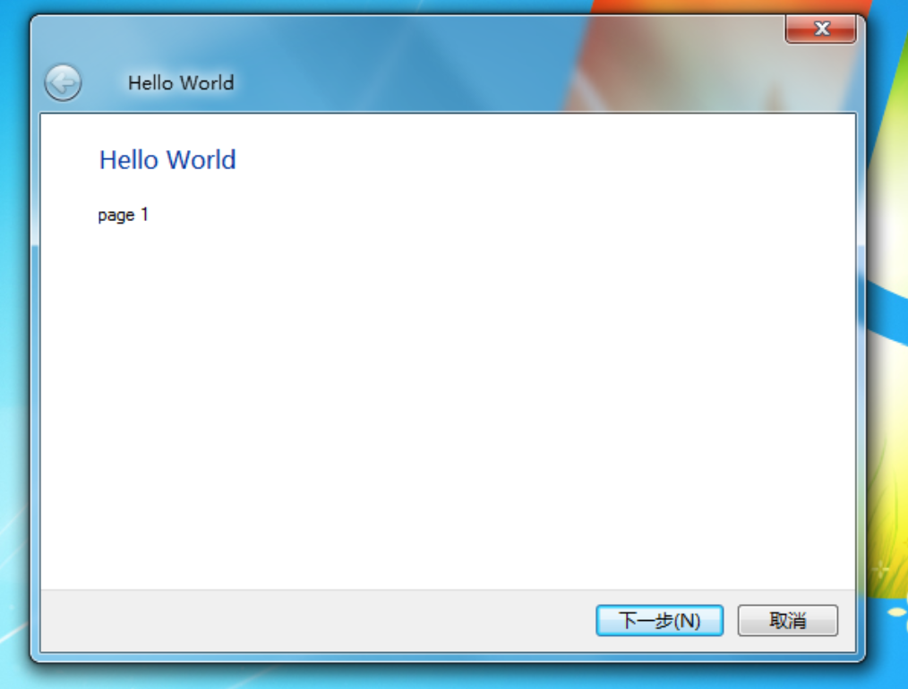
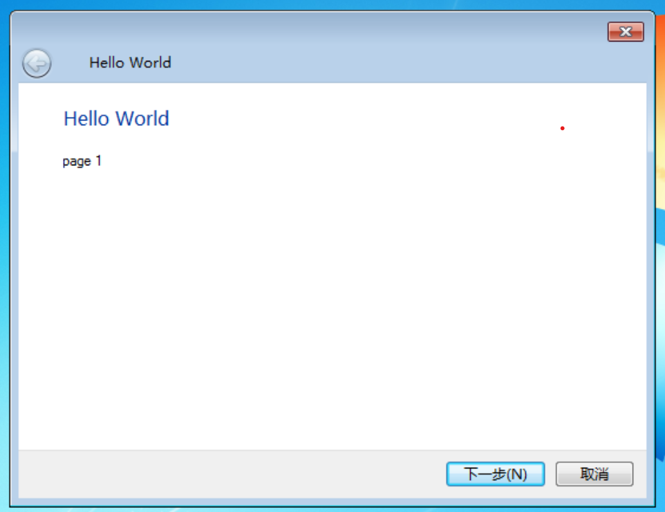
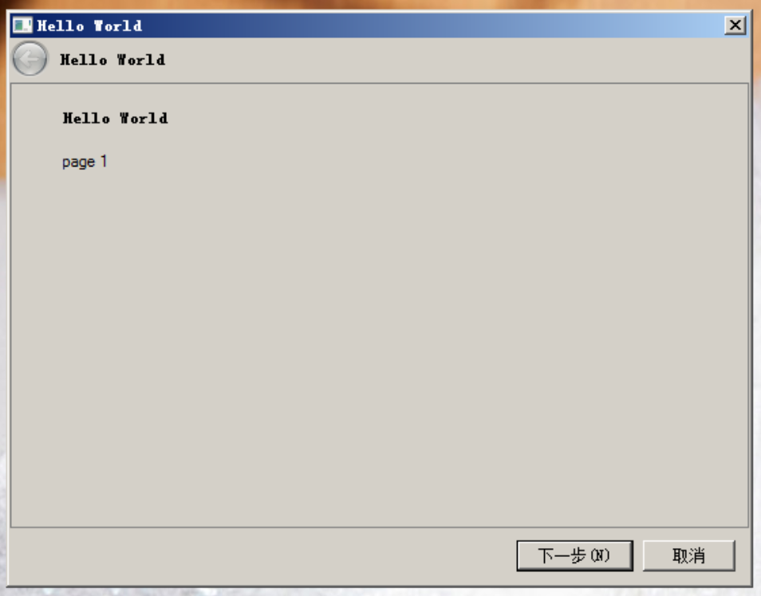
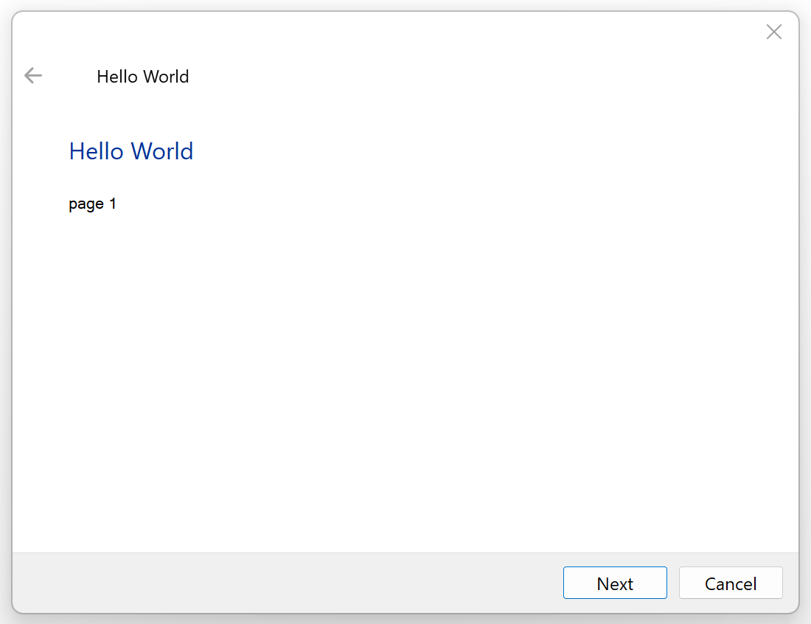
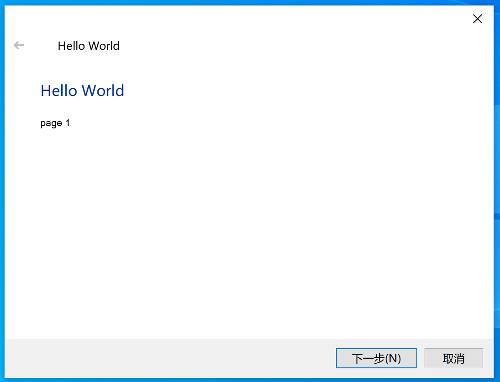
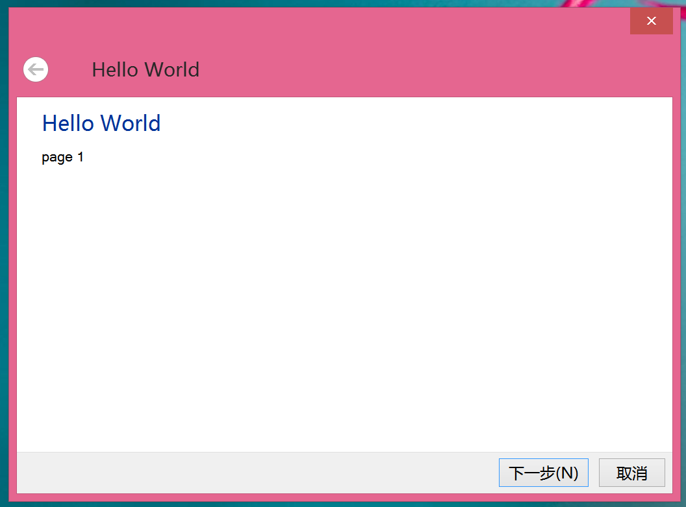

# Aero Wizard Sample

小时候就蛮喜欢这种Aero风格的对话框，很精致，用AI做了一个出来。

文艺复兴一下说是了。

## 实现以及给AI Agent的指引

其实就是系统的Areo向导对话框，适合用来做一些安装包或者向导之类的，调用系统API实现。

### C++ 实现

* 代码：[cpp/](cpp/) (CMake项目)
* 文档：[docs/aero_wizard_develop_guide_cpp.md](docs/aero_wizard_develop_guide_cpp.md)

### C# 实现 （使用PInvoke）

* 代码：[csharp/](csharp/) (.Net Framework 4.8项目)
* 文档：[docs/aero_wizard_develop_guide.md](docs/aero_wizard_develop_guide.md)

## 屏幕截图

**Win7**

<table>
  <tr>
    <td align="center" width="33%">
      
    </td>
    <td align="center" width="33%">
      
    </td>
    <td align="center" width="33%">
      
    </td>
  </tr>
</table>

**Win8/Win10/Win11**

<table>
  <tr>
    <td align="center" width="33%">
      
    </td>
    <td align="center" width="33%">
      
    </td>
    <td align="center" width="33%">
      
    </td>
  </tr>
</table>

--------------------

by Melina, 2026.10
